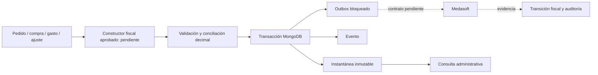
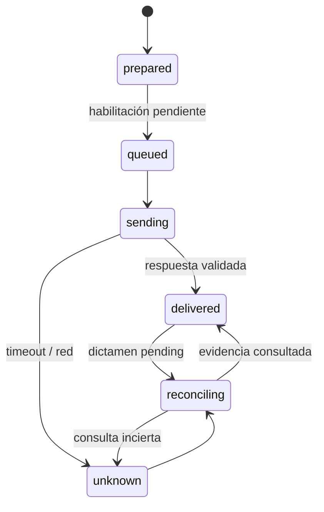

# Arquitectura y operación

El pedido conserva sus importes, pago e inventario. El módulo fiscal no reemplaza checkout, Better Auth ni Finanzas. No existe emisor automático activo.

## Persistencia

- `FiscalInvoice`: identidad fiscal independiente, origen, tipo, ambiente, emisor, instantánea JSON validada y hash SHA-256, referencia original, e-NCF, identificador proveedor, transmisión, dictamen y versión. Instantánea oculta por defecto y protegida contra actualización/reemplazo. Los datos de comprador no se releen del perfil.
- `FiscalEvent`: eventos inmutables por documento/versión. Solo actor, acción, código y fecha; no cuerpo HTTP, token, contraseña, RNC del comprador ni stack externo.
- `FiscalOutbox`: una entrada por documento; inicialmente `blocked`. Sin TTL. No worker ni cron habilitado.
- `FiscalSettings`: configuración por emisor/ambiente, tipos solicitados, revisión/autorización y versiones de reglas/contrato. Sin secretos. Una bandera de BD no puede superar el bloqueo de código.

El servicio deriva idempotencia de origen + ID de operación + emisor + ambiente. E31/E32/E45 comparten la identidad de una venta; cambiar de tipo no crea otra factura. Ajustes requieren IDs de operación propios y referencia original. Mismo origen y contenido devuelve el mismo documento; contenido distinto produce `IDEMPOTENCY_CONFLICT`.

`prepareFiscalDraft` es una API interna de preparación Sandbox, sin endpoint público y sin documento válido fiscalmente. Sus callers futuros deben construir desde la operación comercial autorizada; nunca pasar el cuerpo del navegador como instantánea. La validación de montos no reemplaza las reglas de cada tipo.

Las escrituras de documento/evento/cola y la reserva E34 comparten `runTransaction`. Requiere replica set; no hay fallback no atómico. No se hacen llamadas HTTP dentro de callbacks reintentables. Ante resultado de commit desconocido, leer por la misma identidad; no cambiar la clave.

Créditos: original aceptado, emisor/ambiente/comprador/moneda coincidentes, reserva acumulada atómica en centavos seguros. La reserva incluye borradores pendientes; no se libera automáticamente tras timeout o rechazo. Falta validar ajustes tributarios por línea, códigos/motivos/plazos y enlace con devoluciones comerciales. Débitos conservan original y trazabilidad; reglas específicas pendientes. No están habilitados para emisión.

## Estados

Dictamen separado: `unverified`, `pending`, `accepted`, `conditionally_accepted`, `rejected`. Pago nunca modifica dictamen. Dictámenes terminales se preservan. La transición persistente usa versión esperada y escribe evento en la misma transacción. `unknown` no vuelve a `queued` ni a `sending`. Cola y envío están bloqueados en código hasta completar contrato. Estados internos no pretenden enumerar todo el protocolo DGII.

## Dinero

Strings decimales y BigInt durante cálculo; sin floats críticos. Los campos acumulados de MongoDB usan centavos enteros seguros para permitir incremento y comparación atómicos. Precios/cantidades admiten cuatro decimales; importes persistidos, dos. Half-up por línea y reparto proporcional con restos deterministas son primitivas de cálculo, pendientes de aprobación del mapeo fiscal por tipo. No hay tasa predeterminada ni clasificación derivada del nombre del producto.

Transporte y cargos deben aparecer como líneas clasificadas explícitamente. El total comercial debe coincidir exactamente con total fiscal + partidas no facturables; el servicio rechaza discrepancias. El cálculo comercial `calculateCheckoutTotals` permanece intacto. No están implementadas retenciones ni conciliación de pagos parciales con obligación de emisión.

## Consulta y PDF

- `GET /api/admin/fiscal`: filtro por tipo, dictamen, ambiente y búsqueda exacta de referencia/e-NCF/origen; 25 filas por página, máximo 1000 páginas.
- `GET /api/admin/fiscal/capabilities`: catálogo efectivo; todo deshabilitado.
- `GET /api/admin/fiscal/:id?afterVersion=N`: trazabilidad paginada (100 eventos), sin instantánea/archivos privados.
- `/admin/fiscal`, `/admin/fiscal/:id`: páginas solo administrador, enlace desde Finanzas. Clientes y personal sin rol administrador no acceden.
- Sin endpoints fiscales de escritura ni descarga de documentos autorizados. Ningún GET emite ni reconcilia.
- PDF de pedido reutiliza el renderer existente, rotulado comercial, con número de pedido y aviso no e-CF. Representación autorizada pendiente; no se inventa QR ni e-NCF.

## Errores y reconciliación

| Código | Significado / acción |
| --- | --- |
| `ISSUANCE_BLOCKED`, `PROVIDER_UNVERIFIED` | No enviar. Resolver contrato, autorización, clasificación y revisión. |
| `INVALID_ORIGIN`, `UNSUPPORTED_TYPE` | Corregir origen/tipo; compras y gastos nunca checkout. |
| `INVALID_BUYER`, `INVALID_AMOUNT`, `TOTALS_MISMATCH` | Corregir borrador antes de emitir; no alterar original emitido. |
| `IDEMPOTENCY_CONFLICT` | Misma operación con contenido distinto; revisión humana, no generar otra clave de venta. |
| `CONCURRENT_OPERATION` | Recargar versión y estado antes de nueva acción. |
| `OUTCOME_UNKNOWN` | Conservar identidad y evidencia. Consultar proveedor con contrato validado; nunca reenvío ciego. |
| `CREDIT_LIMIT` | Reserva excede disponible. Revisar notas previas y reservas; no liberar por timeout. |

Procedimiento: localizar por operación/e-NCF, revisar eventos y ambiente, confirmar identificador con proveedor, consultar estado mediante contrato validado, cotejar emisor/tipo/e-NCF y guardar transición con versión esperada. Actualmente no hay consulta HTTP automatizada verificada; no cambiar el dictamen manualmente basándose solo en pago, PDF o código HTTP. No registrar respuestas crudas con información fiscal sensible.

Acceso directo a colecciones con credenciales de DBA puede eludir middleware Mongoose. Producción requiere permisos mínimos, respaldo, retención aprobada y validadores MongoDB revisados; no se presenta el hash como prueba criptográfica de firma DGII.
